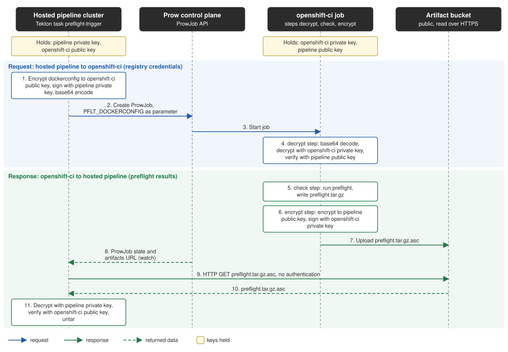

# GPG Key Management and Rotation

This document describes how `preflight-trigger` uses OpenPGP keys to exchange data between openshift-ci and the cluster that runs the hosted certification pipeline, where each key is stored, how to generate key pairs, and how to rotate them.

## Overview

Two systems exchange data through `preflight-trigger`:

* **openshift-ci**: Prow and the `ci-operator` jobs it runs. The steps that call `preflight-trigger` are defined in [`openshift/release`](https://github.com/openshift/release/tree/main/ci-operator/step-registry/operator-pipelines) under `ci-operator/step-registry/operator-pipelines/preflight-prod` and `preflight-preprod`.
* **Hosted pipeline**: the Tekton task `preflight-trigger`, which runs in the OpenShift cluster that hosts the certification pipelines. The task is defined in [`redhat-openshift-ecosystem/operator-pipelines`](https://github.com/redhat-openshift-ecosystem/operator-pipelines/blob/main/ansible/roles/operator-pipeline/templates/openshift/tasks/preflight-trigger.yml).

Data moves in both directions. The hosted pipeline sends registry credentials to openshift-ci, and openshift-ci sends preflight results back. Both transports are readable by parties outside the two systems (see [Channels](#channels)), so every message is encrypted to the receiver's public key and signed with the sender's private key.

* `preflight-trigger encrypt` encrypts with `--gpg-encryption-public-key` and signs with `--gpg-encryption-private-key` (`KeyRing.Encrypt` in `ProtonMail/gopenpgp`).
* `preflight-trigger decrypt` decrypts with `--gpg-decryption-private-key` and verifies the signature with `--gpg-decryption-public-key` (`KeyRing.Decrypt`). Decryption fails when the signature does not verify.

Two key pairs exist. Each system holds its own private key and the other system's public key.

| Key pair | OpenPGP real name | Private key stored in | Public key stored in |
|----------|-------------------|-----------------------|----------------------|
| openshift-ci | `Preflight Trigger` | Google Secret Manager, collection `operator-pipelines`, field `operator-pipelines-gpg/private` | OpenShift Secret `preflight-decryption-key`, key `public` |
| Hosted pipeline | `Operator Pipelines` | OpenShift Secret `preflight-decryption-key`, key `private` | Google Secret Manager, collection `operator-pipelines`, field `operator-pipelines-gpg/public` |

The real names are a convention stated in the step scripts in `openshift/release`. `preflight-trigger` does not read the real name.

> Code references: [`cmd/encrypt.go`](../cmd/encrypt.go) lines 36-113, [`cmd/decrypt.go`](../cmd/decrypt.go) lines 33-106, [`cmd/root.go`](../cmd/root.go) lines 84-87 for the key flags, [`cmd/job.go`](../cmd/job.go) for ProwJob creation, [`cmd/artifacts.go`](../cmd/artifacts.go) for the result download. The key flags accept file paths to armored keys.

## Communication Between openshift-ci and the Hosted Pipeline

### Participants

| Participant | Role | Defined in |
|-------------|------|------------|
| Hosted pipeline task | Tekton task `preflight-trigger`. Sends the request, waits for the job, fetches and decrypts the response. | `operator-pipelines`: `ansible/roles/operator-pipeline/templates/openshift/tasks/preflight-trigger.yml` |
| Prow control plane | Kubernetes API that stores ProwJob objects and starts the job. | `openshift/release`: `core-services/prow/02_config/_config.yaml` |
| openshift-ci job | `ci-operator` workflow `operator-pipelines-preflight-<env>-claim` (`-aws` for OCP 4.6 and 4.7). Its test steps run in this order: `decrypt`, `check`, `encrypt`. | `openshift/release`: `ci-operator/step-registry/operator-pipelines/preflight-<env>/` |
| Artifact bucket | Stores the job artifacts. Served under `https://gcs.ci.openshift.org/gcs/test-platform-results-public/logs/`, the default of `--artifacts-base-url`. | [`cmd/defaults.go`](../cmd/defaults.go) |

`<env>` is `prod` or `preprod`. Pass it with `--environment`. The CLI default is `common`, and `openshift/release` defines step-registry directories for `preflight-prod` and `preflight-preprod` only.

### Channels

| Channel | Used for | Authentication | Who else can read it |
|---------|----------|----------------|----------------------|
| GitHub contents API | `create job` reads the Prow configuration and the periodic job definition from `openshift/release`. | Optional `GITHUB_AUTH_TOKEN` | Public data |
| Prow Kubernetes API | `create job` creates the ProwJob and watches its state. Job parameters travel as `--multi-stage-param` arguments in the ProwJob pod spec. | Kubeconfig named by `KUBECONFIG`; the task mounts it from Secret `prow-kubeconfig`, key `kubeconfig` | Any user who can read ProwJob objects. Prow also stores the spec as `prowjob.json` with the job artifacts. |
| Artifact URL | `artifacts` downloads `preflight.tar.gz.asc`. | None (`http.Get`) | Anyone who has the URL |

The hosted pipeline opens every connection. openshift-ci never connects to the hosted pipeline cluster.

### Request: hosted pipeline to openshift-ci

The request carries registry credentials (`dockerconfigjson`) for private images under test. The task sends it only when `project_dockerconfigjson` exists in its `credentials` workspace.

1. Task step `sanitize-docker-config-json` reduces the file to its `auths` section.
2. Task step `encrypt-and-encode-docker-config-json` encrypts the file to the openshift-ci public key, signs it with the hosted pipeline private key, and base64-encodes the armored result:

   ```bash
   preflight-trigger encrypt \
     --gpg-encryption-private-key /etc/gpg-key/private \
     --gpg-encryption-public-key /etc/gpg-key/public \
     --file project_dockerconfigjson \
     --output-path project_dockerconfigjson.gpg

   preflight-trigger encode \
     --file project_dockerconfigjson.gpg \
     --output-path project_dockerconfigjson.gpg.b64
   ```

3. Task step `create-openshift-ci-prowjob` exports the encoded text as `PFLT_DOCKERCONFIG` and runs `preflight-trigger create job`. The command:
   * reads `_config.yaml` and the periodic `periodic-ci-redhat-openshift-ecosystem-certified-operators-<env>-ocp-<version>-preflight-<env>-claim` from `openshift/release`;
   * builds a ProwJob from that periodic and appends `--multi-stage-param=PFLT_DOCKERCONFIG=<value>` together with the other `PFLT_*`, `TEST_ASSET`, and `ASSET_TYPE` parameters;
   * creates the ProwJob and watches it until it succeeds, fails, or 90 minutes pass (the Tekton step itself times out after 1h15m);
   * writes the job state, artifacts URL, and job URL as JSON to `prowjob-base-url`.
4. Workflow step `operator-pipelines-preflight-<env>-decrypt` decodes the parameter, decrypts it with the openshift-ci private key, and verifies the signature with the hosted pipeline public key:

   ```bash
   preflight-trigger decode --value ${PFLT_DOCKERCONFIG} | preflight-trigger decrypt \
     --gpg-decryption-private-key /var/run/operator-pipelines-gpg/private \
     --gpg-decryption-public-key /var/run/operator-pipelines-gpg/public \
     --output-path ${SHARED_DIR}/decrypted_config.json
   ```

5. Workflow step `operator-pipelines-preflight-<env>-check` sets `PFLT_DOCKERCONFIG` to `${SHARED_DIR}/decrypted_config.json` when that file exists and runs preflight.

### Response: openshift-ci to hosted pipeline

The response carries the preflight results and logs.

1. The `check` step writes `${SHARED_DIR}/preflight.tar.gz`. The archive contains the preflight artifacts directory, `preflight.log`, and the captured stdout and stderr.
2. Workflow step `operator-pipelines-preflight-<env>-encrypt` encrypts the archive to the hosted pipeline public key, signs it with the openshift-ci private key, and moves the result to `${ARTIFACT_DIR}`, which openshift-ci uploads to the artifact bucket:

   ```bash
   preflight-trigger encrypt \
     --gpg-encryption-private-key /var/run/operator-pipelines-gpg/private \
     --gpg-encryption-public-key /var/run/operator-pipelines-gpg/public \
     --file ${SHARED_DIR}/preflight.tar.gz \
     --output-path ${SHARED_DIR}/preflight.tar.gz.asc
   ```

3. Task step `get-prowjob-artifacts-and-decrypt` runs `preflight-trigger artifacts`. The command takes the job ID from the last path segment of `prowjob_artifacts_url` in `prowjob-base-url` and downloads:

   ```
   <artifacts-base-url>/<job-name>/<job-id>/artifacts/preflight-<env>-claim/operator-pipelines-preflight-<env>-encrypt/artifacts/preflight.tar.gz.asc
   ```

4. The same task step decrypts the archive with the hosted pipeline private key, verifies the signature with the openshift-ci public key, and extracts it:

   ```bash
   preflight-trigger decrypt \
     --gpg-decryption-private-key /etc/gpg-key/private \
     --gpg-decryption-public-key /etc/gpg-key/public \
     --file preflight.tar.gz.asc \
     --output-path preflight.tar.gz

   preflight-trigger artifacts --untar
   ```

### Key Use per Direction

| Direction | Operation | Runs in | Key | Flag | Read from |
|-----------|-----------|---------|-----|------|-----------|
| Request | Encrypt | Hosted pipeline | openshift-ci public | `--gpg-encryption-public-key` | Secret `preflight-decryption-key`, key `public` |
| Request | Sign | Hosted pipeline | Hosted pipeline private | `--gpg-encryption-private-key` | Secret `preflight-decryption-key`, key `private` |
| Request | Decrypt | openshift-ci | openshift-ci private | `--gpg-decryption-private-key` | Secret Manager field `operator-pipelines-gpg/private` |
| Request | Verify | openshift-ci | Hosted pipeline public | `--gpg-decryption-public-key` | Secret Manager field `operator-pipelines-gpg/public` |
| Response | Encrypt | openshift-ci | Hosted pipeline public | `--gpg-encryption-public-key` | Secret Manager field `operator-pipelines-gpg/public` |
| Response | Sign | openshift-ci | openshift-ci private | `--gpg-encryption-private-key` | Secret Manager field `operator-pipelines-gpg/private` |
| Response | Decrypt | Hosted pipeline | Hosted pipeline private | `--gpg-decryption-private-key` | Secret `preflight-decryption-key`, key `private` |
| Response | Verify | Hosted pipeline | openshift-ci public | `--gpg-decryption-public-key` | Secret `preflight-decryption-key`, key `public` |

Each system passes the same two files to both `encrypt` and `decrypt`: its own private key and the other system's public key.

### Sequence Diagram



Mermaid source of the same diagram:

```text
sequenceDiagram
    autonumber
    participant P as Hosted pipeline cluster<br/>Tekton task preflight-trigger
    participant K as Prow control plane<br/>ProwJob API
    participant J as openshift-ci job<br/>steps decrypt, check, encrypt
    participant G as Artifact bucket<br/>public, read over HTTPS

    Note over P: Holds pipeline private key and openshift-ci public key
    Note over J: Holds openshift-ci private key and pipeline public key

    rect rgb(241, 246, 252)
        Note over P,J: Request (registry credentials)
        P->>P: Encrypt dockerconfig to openshift-ci public key, sign with pipeline private key, base64 encode
        P->>K: Create ProwJob, PFLT_DOCKERCONFIG as parameter
        K->>J: Start job
        J->>J: decrypt step: base64 decode, decrypt with openshift-ci private key, verify with pipeline public key
    end

    rect rgb(240, 248, 243)
        Note over P,G: Response (preflight results)
        J->>J: check step: run preflight, write preflight.tar.gz
        J->>J: encrypt step: encrypt to pipeline public key, sign with openshift-ci private key
        J->>G: Upload preflight.tar.gz.asc
        K-->>P: ProwJob state and artifacts URL (watch)
        P->>G: HTTP GET preflight.tar.gz.asc, no authentication
        G-->>P: preflight.tar.gz.asc
        P->>P: Decrypt with pipeline private key, verify with openshift-ci public key, untar
    end
```

## Flags and Environment

| Flag | Env var | Used by | Key to supply |
|------|---------|---------|---------------|
| `--gpg-encryption-public-key` | `GPG_ENCRYPTION_PUBLIC_KEY` | `encrypt` | Path to the receiver's armored public key |
| `--gpg-encryption-private-key` | `GPG_ENCRYPTION_PRIVATE_KEY` | `encrypt` | Path to the sender's armored private key |
| `--gpg-decryption-public-key` | `GPG_DECRYPTION_PUBLIC_KEY` | `decrypt` | Path to the sender's armored public key |
| `--gpg-decryption-private-key` | `GPG_DECRYPTION_PRIVATE_KEY` | `decrypt` | Path to the receiver's armored private key |

The message input differs between the two commands:

* `encrypt` reads the plaintext from `--pflt-docker-config` (a file path), then `--file`, then stdin.
* `decrypt` reads the armored message from `--pflt-docker-config` (the message text itself), then `--file`, then stdin.

`GPG_PASSPHRASE` is read from the environment in `encryptPreRun` and `decryptPreRun` and is not used afterwards. A passphrase-protected private key fails with `Error creating new private key ring: gopenpgp: unable to add locked key to a keyring`. Use unprotected private keys, or extend `cmd/encrypt.go` and `cmd/decrypt.go` to call `Key.Unlock`.

## Key Storage

### openshift-ci Side: Secret Manager

The openshift-ci keys are stored in Google Secret Manager and managed with the OpenShift CI Secret Manager CLI (`hack/secret-manager.sh` in `openshift/release`, aliased `sm` in this document). See [Using the Secret Manager CLI](https://docs.ci.openshift.org/architecture/cli-secret-manager/). Members of a Rover group with access to the collection can create, update, and delete fields. Only CI infrastructure can read the values.

| Collection | Field | Content | Mounted in the step as |
|------------|-------|---------|------------------------|
| `operator-pipelines` | `operator-pipelines-gpg/private` | openshift-ci private key (`Preflight Trigger`) | `/var/run/operator-pipelines-gpg/private` |
| `operator-pipelines` | `operator-pipelines-gpg/public` | Hosted pipeline public key (`Operator Pipelines`) | `/var/run/operator-pipelines-gpg/public` |

The `decrypt` and `encrypt` step definitions mount the group with this stanza:

```yaml
credentials:
  - collection: operator-pipelines
    group: operator-pipelines-gpg
    mount_path: /var/run/operator-pipelines-gpg
```

The `preflight-prod` and `preflight-preprod` steps mount the same group. A change to either field applies to both environments.

#### Secret Manager CLI Setup

* `gcloud` CLI and `podman` (or `docker` with `CONTAINER_ENGINE=docker`) installed.
* A clone of `openshift/release`:

  ```bash
  git clone https://github.com/openshift/release.git
  alias sm="./release/hack/secret-manager.sh"
  sm login   # Authenticates via Red Hat SSO (browser flow, caches locally)
  sm clean   # Clears cached credentials
  ```

* A Rover group with access to the collection. Access is granted in `core-services/sync-rover-groups/_config.yaml` under `groups.<rover-group>.secret_collections`. After the pull request merges, the postsubmit `branch-ci-openshift-release-main-gsm-secrets-reconciler` syncs access.
* Verify access:

  ```bash
  sm list -c operator-pipelines                                   # fields in the collection
  sm list --rover-group <rover-group>                             # collections for the group
  sm describe -c operator-pipelines operator-pipelines-gpg/private  # metadata only
  ```

#### Commands

```bash
# Update an existing field (rotation)
sm update -c operator-pipelines operator-pipelines-gpg/private --from-file ./ci-private.asc
sm update -c operator-pipelines operator-pipelines-gpg/public  --from-file ./pipeline-public.asc

# Create a field that does not exist yet
# Prompts for: Jira project, rotation information, request information
sm create -c operator-pipelines operator-pipelines-gpg/private --from-file ./ci-private.asc
sm create -c operator-pipelines operator-pipelines-gpg/public  --from-file ./pipeline-public.asc
```

Notes:

* An update is used by CI job instances that start after it.
* The backing storage retains previous versions. `sm` serves the latest version and has no command to return to a previous one.
* `sm` never returns a value. Keep a copy of the current openshift-ci private key outside Secret Manager if rollback must be possible.
* Direct access to the backing Google Secret Manager project (`gcloud secrets versions add|access|disable`) requires IAM permissions that Rover group membership does not grant.

### Hosted Pipeline Side: OpenShift Secret

The hosted pipeline keys are stored in the Secret `preflight-decryption-key` in the namespace of the operator-pipelines deployment.

| Secret key | Content | Mounted in the task as |
|------------|---------|------------------------|
| `private` | Hosted pipeline private key (`Operator Pipelines`) | `/etc/gpg-key/private` |
| `public` | openshift-ci public key (`Preflight Trigger`) | `/etc/gpg-key/public` |

An administrator generates the key material. The Secret object is created from files in the `operator-pipelines` repository by the Ansible task `Create preflight decryption key secret` in [`ansible/roles/operator-pipeline/tasks/pipeline-secrets.yml`](https://github.com/redhat-openshift-ecosystem/operator-pipelines/blob/main/ansible/roles/operator-pipeline/tasks/pipeline-secrets.yml), which runs with `force: true`.

| Inventory | Private key file (Ansible Vault encrypted) | Public key file (plain armored text) |
|-----------|--------------------------------------------|--------------------------------------|
| Default (`group_vars/operator-pipeline.yml`) | `ansible/vaults/common/preflight-decryption-key-priv.gpg` | `ansible/vaults/common/preflight-decryption-key-pub` |
| Production (`group_vars/operator-pipeline-prod.yml`) | `ansible/vaults/prod/preflight-decryption-key-priv.gpg` | `ansible/vaults/prod/preflight-decryption-key-pub` |

Constraints:

* A change applied to the Secret with `oc` is replaced by the repository files on the next deployment. Change the repository files to make a change permanent.
* Both openshift-ci environments read one Secret Manager group, so the `common` and `prod` files must hold keys that match that group.
* Each Tekton step pod reads the Secret when it starts. A changed Secret is used by steps that start after the change. No restart is required.
* The same task mounts Secret `prow-kubeconfig`, key `kubeconfig`, to reach the Prow Kubernetes API.

Inspect the keys currently in the Secret (`gpg --show-keys` prints key metadata and no key material):

```bash
NAMESPACE=<operator-pipelines namespace>

oc get secret preflight-decryption-key -n "${NAMESPACE}" -o jsonpath='{.data.public}' \
  | base64 -d | gpg --show-keys --with-fingerprint    # expect uid "Preflight Trigger"

oc get secret preflight-decryption-key -n "${NAMESPACE}" -o jsonpath='{.data.private}' \
  | base64 -d | gpg --show-keys --with-fingerprint    # expect uid "Operator Pipelines"
```

## Generating a New Key Pair

`preflight-trigger` uses `github.com/ProtonMail/gopenpgp/v2`. Any OpenPGP generator that produces ASCII-armored, unprotected keys works.

Requirements:

* The openshift-ci pair has the real name `Preflight Trigger`. The hosted pipeline pair has the real name `Operator Pipelines`.
* The private key has no passphrase (see [Flags and Environment](#flags-and-environment)).
* Generate only the pair being rotated.

This document uses these file names:

| File | Content |
|------|---------|
| `ci-private.asc` | openshift-ci private key |
| `ci-public.asc` | openshift-ci public key |
| `pipeline-private.asc` | Hosted pipeline private key |
| `pipeline-public.asc` | Hosted pipeline public key |

### Option A: GnuPG

```bash
# 1. Use a temporary keyring so the export contains only the new key
export GNUPGHOME="$(mktemp -d)"

# 2. Generate the pair. Set NAME to "Preflight Trigger" or "Operator Pipelines".
NAME="Preflight Trigger"
gpg --batch --generate-key <<KEYCFG
Key-Type: RSA
Key-Length: 4096
Subkey-Type: RSA
Subkey-Length: 4096
Name-Real: ${NAME}
Expire-Date: 0
%no-protection
%commit
KEYCFG

# 3. Export armored keys. Use the pipeline-* file names for "Operator Pipelines".
gpg --armor --export-secret-keys "${NAME}" > ci-private.asc
gpg --armor --export             "${NAME}" > ci-public.asc

# 4. Verify the real name and fingerprint of each file
gpg --show-keys --with-fingerprint ci-private.asc ci-public.asc

# 5. Remove the temporary keyring
gpgconf --kill gpg-agent
rm -rf "${GNUPGHOME}"
unset GNUPGHOME
```

Set `Expire-Date` according to the key expiry policy in force. `0` means no expiry.

### Option B: ProtonMail/gopenpgp

```go
package main

import (
	"log"
	"os"

	"github.com/ProtonMail/gopenpgp/v2/crypto"
)

// writePair generates an unprotected RSA 4096 key pair and writes
// <prefix>-private.asc and <prefix>-public.asc to the current directory.
func writePair(realName, prefix string) {
	key, err := crypto.GenerateKey(realName, "", "rsa", 4096)
	if err != nil {
		log.Fatalf("generate %q: %v", realName, err)
	}
	private, err := key.Armor()
	if err != nil {
		log.Fatalf("armor private key %q: %v", realName, err)
	}
	public, err := key.GetArmoredPublicKey()
	if err != nil {
		log.Fatalf("armor public key %q: %v", realName, err)
	}
	if err := os.WriteFile(prefix+"-private.asc", []byte(private), 0o600); err != nil {
		log.Fatal(err)
	}
	if err := os.WriteFile(prefix+"-public.asc", []byte(public), 0o644); err != nil {
		log.Fatal(err)
	}
}

func main() {
	// Keep only the call for the pair being rotated.
	writePair("Preflight Trigger", "ci")
	writePair("Operator Pipelines", "pipeline")
}
```

## Rotating Keys

Rotating one key pair changes one value in each store:

| Rotated pair | Secret Manager field to update | Hosted pipeline file and Secret key to update |
|--------------|--------------------------------|-----------------------------------------------|
| openshift-ci (`Preflight Trigger`) | `operator-pipelines-gpg/private` with `ci-private.asc` | `preflight-decryption-key-pub`, Secret key `public`, with `ci-public.asc` |
| Hosted pipeline (`Operator Pipelines`) | `operator-pipelines-gpg/public` with `pipeline-public.asc` | `preflight-decryption-key-priv.gpg`, Secret key `private`, with `pipeline-private.asc` |

### Constraints

* The two stores are updated with separate tools. No transaction covers both.
* From the first update until the second one is deployed, the two systems hold keys from different generations and every run fails in a `decrypt` call (see [Troubleshooting](#troubleshooting)).
* A run that starts before the updates and finishes after them fails the same way.
* Runs that fail for these reasons pass when they are re-run after both updates are deployed.
* Rotation applies to the `prod` and `preprod` environments together, because both read one Secret Manager group.
* The current implementation loads one key per flag. Accepting an old and a new key during a transition requires a code change in `cmd/decrypt.go` to build key rings with more than one key.

### Prerequisites

* Access to the `operator-pipelines` collection through `sm` (see [Secret Manager CLI Setup](#secret-manager-cli-setup)).
* Write access to `redhat-openshift-ecosystem/operator-pipelines` and the Ansible Vault password for it.
* `oc` access to the namespace of the operator-pipelines deployment.
* A period with no certification pipeline runs in progress, or agreement that runs in progress are re-run.
* When rotating the openshift-ci pair: a copy of the current openshift-ci private key outside Secret Manager, if rollback must be possible.

### Steps

1. Generate the new pair (see [Generating a New Key Pair](#generating-a-new-key-pair)).

2. Collect the four key files in one directory. Use the new files for the rotated pair. For the other pair, use the deployed keys when both files are available, or a throwaway pair generated for this test. The openshift-ci private key cannot be read back from Secret Manager.

3. Test both directions locally:

   ```bash
   # Request direction: hosted pipeline to openshift-ci
   preflight-trigger encrypt --file ./config.json \
     --gpg-encryption-public-key ./ci-public.asc \
     --gpg-encryption-private-key ./pipeline-private.asc \
     --output-path ./config.json.gpg
   preflight-trigger encode --file ./config.json.gpg --output-path ./config.json.gpg.b64
   preflight-trigger decode --value "$(cat ./config.json.gpg.b64)" | preflight-trigger decrypt \
     --gpg-decryption-private-key ./ci-private.asc \
     --gpg-decryption-public-key ./pipeline-public.asc \
     --output-path ./decrypted_config.json
   cmp ./config.json ./decrypted_config.json      # no output, exit status 0

   # Response direction: openshift-ci to hosted pipeline
   preflight-trigger encrypt --file ./results.tar.gz \
     --gpg-encryption-public-key ./pipeline-public.asc \
     --gpg-encryption-private-key ./ci-private.asc \
     --output-path ./preflight.tar.gz.asc
   preflight-trigger decrypt --file ./preflight.tar.gz.asc \
     --gpg-decryption-private-key ./pipeline-private.asc \
     --gpg-decryption-public-key ./ci-public.asc \
     --output-path ./preflight.tar.gz
   cmp ./results.tar.gz ./preflight.tar.gz        # no output, exit status 0
   ```

   `config.json` is any `dockerconfigjson` file and `results.tar.gz` is any gzip-compressed tar archive.

4. Update Secret Manager. Run the line for the rotated pair:

   ```bash
   # openshift-ci pair rotated
   sm update -c operator-pipelines operator-pipelines-gpg/private --from-file ./ci-private.asc

   # Hosted pipeline pair rotated
   sm update -c operator-pipelines operator-pipelines-gpg/public --from-file ./pipeline-public.asc
   ```

5. Update the hosted pipeline files in a checkout of `redhat-openshift-ecosystem/operator-pipelines`. Run the block for the rotated pair:

   ```bash
   # openshift-ci pair rotated: the public key file is stored as plain armored text
   cp ./ci-public.asc ansible/vaults/common/preflight-decryption-key-pub
   cp ./ci-public.asc ansible/vaults/prod/preflight-decryption-key-pub

   # Hosted pipeline pair rotated: the private key file is Ansible Vault encrypted
   ansible-vault encrypt --vault-password-file "${VAULT_PASSWORD_PATH}" \
     --output ansible/vaults/common/preflight-decryption-key-priv.gpg ./pipeline-private.asc
   ansible-vault encrypt --vault-password-file "${VAULT_PASSWORD_PATH}" \
     --output ansible/vaults/prod/preflight-decryption-key-priv.gpg ./pipeline-private.asc
   ```

   Merge the change and deploy it with the operator-pipelines deployment procedure. The [operator-pipelines developer guide](https://github.com/redhat-openshift-ecosystem/operator-pipelines/blob/main/docs/developer-guide.md) documents this manual command:

   ```bash
   ansible-playbook -v \
     -i "ansible/inventory/operator-pipeline-${ENV}" \
     -e "oc_namespace=${NAMESPACE}" \
     -e "ocp_token=$(oc whoami -t)" \
     --vault-password-file "${VAULT_PASSWORD_PATH}" \
     ansible/playbooks/deploy.yml
   ```

   To shorten the period in which the two stores disagree, the Secret can be updated directly before the deployment runs. The next deployment replaces this Secret with the repository files, so the repository change above is still required:

   ```bash
   # Both files are required: the first is the hosted pipeline private key,
   # the second is the openshift-ci public key.
   oc create secret generic preflight-decryption-key \
     --from-file=private=./pipeline-private.asc \
     --from-file=public=./ci-public.asc \
     -n "${NAMESPACE}" --dry-run=client -o yaml | oc apply -f -
   ```

6. Verify both stores:

   ```bash
   sm list -c operator-pipelines
   sm describe -c operator-pipelines operator-pipelines-gpg/private   # metadata only
   sm describe -c operator-pipelines operator-pipelines-gpg/public    # metadata only

   # Fingerprints in the Secret must equal the fingerprints of the local files
   gpg --show-keys --with-fingerprint ./ci-public.asc ./pipeline-private.asc
   oc get secret preflight-decryption-key -n "${NAMESPACE}" -o jsonpath='{.data.public}' \
     | base64 -d | gpg --show-keys --with-fingerprint
   oc get secret preflight-decryption-key -n "${NAMESPACE}" -o jsonpath='{.data.private}' \
     | base64 -d | gpg --show-keys --with-fingerprint
   ```

   Secret Manager values cannot be read back. The run in step 7 is the test of the Secret Manager contents.

7. Run one job end to end. Either start a hosted pipeline run against a test bundle, or run the task's commands by hand with a kubeconfig for the Prow cluster:

   ```bash
   export KUBECONFIG=<prow kubeconfig>
   export PFLT_DOCKERCONFIG="$(cat ./config.json.gpg.b64)"   # from step 3; tests the request direction

   preflight-trigger create job \
     --environment preprod \
     --ocp-version <version> \
     --asset-type operator \
     --pflt-index-image <index-image> \
     --test-asset <bundle-image>

   preflight-trigger artifacts --environment preprod --ocp-version <version>

   preflight-trigger decrypt \
     --gpg-decryption-private-key ./pipeline-private.asc \
     --gpg-decryption-public-key ./ci-public.asc \
     --file preflight.tar.gz.asc \
     --output-path preflight.tar.gz

   preflight-trigger artifacts --untar
   ```

   Expected results:

   * The log of the `decrypt` step in the ProwJob contains no `Error decrypting message` line. The step exits 0 even when decryption fails, so read the log.
   * `preflight-trigger decrypt` exits 0 and `preflight-trigger artifacts --untar` creates the `artifacts` directory and `preflight.log`.

8. Remove the old key. Delete local copies of the replaced private key when no rollback is planned. Secret Manager retains previous versions in its backing storage, and the previous hosted pipeline files remain in the Git history of `operator-pipelines`.

### Rollback

Rollback is the same procedure with the previous files.

```bash
# openshift-ci pair: restore the previous private key in Secret Manager
sm update -c operator-pipelines operator-pipelines-gpg/private --from-file ./ci-private.prev.asc

# Hosted pipeline pair: restore the previous public key in Secret Manager
sm update -c operator-pipelines operator-pipelines-gpg/public --from-file ./pipeline-public.prev.asc
```

On the hosted pipeline side, revert the commit that changed the files under `ansible/vaults/` in `operator-pipelines` and deploy again. Both stores must return to the same generation of the rotated pair.

When no copy of the previous openshift-ci private key exists outside Secret Manager, rollback of that pair is not possible through `sm`. Rotate forward to another new pair.

## Verification Checklist

* [ ] Each key file has the expected real name (`gpg --show-keys <file>`): `Preflight Trigger` for `ci-*.asc`, `Operator Pipelines` for `pipeline-*.asc`.
* [ ] The private and public file of the rotated pair show the same fingerprint.
* [ ] The local test passes in the request direction and in the response direction.
* [ ] The Secret Manager field for the rotated pair is updated (`private` for the openshift-ci pair, `public` for the hosted pipeline pair).
* [ ] The files under `ansible/vaults/common` and `ansible/vaults/prod` in `operator-pipelines` are updated, merged, and deployed.
* [ ] The fingerprints in Secret `preflight-decryption-key` equal the fingerprints of the local files.
* [ ] One job passes end to end: the `decrypt` step log has no error, and the hosted pipeline side decrypts and extracts `preflight.tar.gz.asc`.
* [ ] Copies of the previous keys are kept until rollback is no longer planned.

## Troubleshooting

| Message or symptom | Cause | Action |
|--------------------|-------|--------|
| `GPG_ENCRYPTION_PUBLIC_KEY and GPG_ENCRYPTION_PRIVATE_KEY must be set` | `encrypt` ran without both key flags. | Pass `--gpg-encryption-public-key` and `--gpg-encryption-private-key`. |
| `Unable to read decryption private key` or `Unable to read encryption private key` | The path does not exist, or the Secret or Secret Manager group is not mounted. | Check the path and the mount. |
| `Error creating new public key from armored` | The file is not an ASCII-armored key. | Export again with `gpg --armor`. |
| `Error creating new private key ring: gopenpgp: unable to add locked key to a keyring` | The private key has a passphrase. | Generate the pair with `%no-protection`. |
| `Error decrypting message: Signature Verification Error: No matching signature` | The file passed as `--gpg-decryption-public-key` is not the sender's public key. After a rotation, the receiver still holds the sender's previous public key, or the sender still signs with its previous private key. | Compare fingerprints on both sides and complete the update in the store that is behind. |
| `Error decrypting message: gopenpgp: error in reading message: openpgp: incorrect key` | The message was encrypted to a public key that does not belong to the private key passed as `--gpg-decryption-private-key`. | Compare fingerprints on both sides and complete the update in the store that is behind. |
| The `decrypt` step log shows `Error decrypting message`, the step passes, and preflight cannot pull private images | The step script does not stop on a failed command. `check` then runs without `decrypted_config.json`. | Fix the key mismatch reported in the log. |
| `Response returned status code other than 200: 404` from `artifacts` | The job did not upload `preflight.tar.gz.asc`. The `encrypt` step failed, or `--environment` or `--ocp-version` differ from the values passed to `create job`. | Read the `encrypt` step log and use the same flag values in both commands. |
| `gpg: can't connect to the gpg-agent: File name too long` | The `GNUPGHOME` path is too long for the agent socket. | Use a shorter directory, for example `mktemp -d`. |
| `You don't have permission to access secrets in collection ...` | The Rover group has no access to the collection. | Add the collection in `core-services/sync-rover-groups/_config.yaml` and wait for the postsubmit `branch-ci-openshift-release-main-gsm-secrets-reconciler`. |
| `Secret ... is in inconsistent state` | The field exists in the index or in storage, and is missing in the other. | Run `sm delete -c operator-pipelines <group/field>`, then `sm create`. |
| `sm get-sa` fails | The collection has no `updater_service_accounts` entry. | Request one if rotation is to be automated. |

## References

* Implementation: [`cmd/encrypt.go`](../cmd/encrypt.go), [`cmd/decrypt.go`](../cmd/decrypt.go), [`cmd/job.go`](../cmd/job.go), [`cmd/artifacts.go`](../cmd/artifacts.go), [`cmd/root.go`](../cmd/root.go)
* openshift-ci steps: https://github.com/openshift/release/tree/main/ci-operator/step-registry/operator-pipelines
* Hosted pipeline task: https://github.com/redhat-openshift-ecosystem/operator-pipelines/blob/main/ansible/roles/operator-pipeline/templates/openshift/tasks/preflight-trigger.yml
* Hosted pipeline Secret definitions: https://github.com/redhat-openshift-ecosystem/operator-pipelines/blob/main/ansible/roles/operator-pipeline/tasks/pipeline-secrets.yml
* Library: `github.com/ProtonMail/gopenpgp/v2`
* GnuPG: https://gnupg.org/documentation/
* OpenShift CI Secret Manager CLI: https://docs.ci.openshift.org/architecture/cli-secret-manager/
* Secret collections config: `openshift/release:core-services/sync-rover-groups/_config.yaml`
